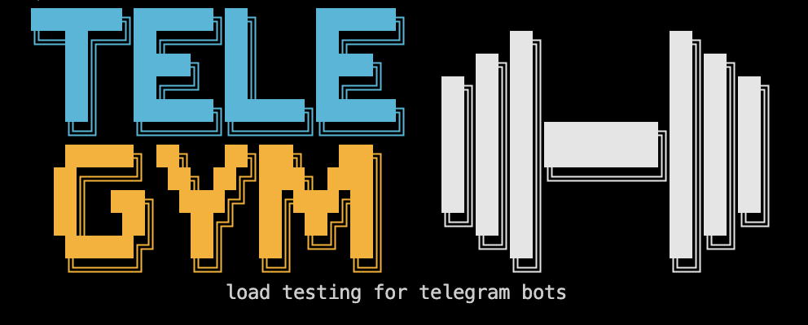

# telegym · load testing for telegram bots (mock + proxy + k6)

[](https://github.com/kolomiichenko/telegym/actions/workflows/ci.yml)
[](https://pkg.go.dev/github.com/kolomiichenko/telegym)
[](https://github.com/kolomiichenko/telegym/blob/main/go.mod)
[](https://core.telegram.org/bots/api)
[](https://opensource.org/licenses/MIT)
[](https://github.com/kolomiichenko/telegym/releases)
[](https://github.com/kolomiichenko/telegym/pkgs/container/telegym-mock)
[](https://deepwiki.com/kolomiichenko/telegym)

<p align="center"></p>

Universal load-testing kit for Telegram bots. Drop-in mock of the Telegram Bot
API plus a k6 extension for writing virtual-user scenarios. Works with any bot
implementation regardless of language - the mock speaks plain HTTP, the bot
points at it via `TELEGRAM_API_URL`.

## Why

- **telegram-test-api** (Node.js) is great for functional smoke tests but not
  designed for thousands of concurrent virtual users.
- **Test DC + Telethon/Pyrogram** uses real Telegram infrastructure - accurate
  but expensive: every virtual user is a real MTProto session, and the test
  DC throttles aggressively above a few hundred clients.
- **k6** is the industry-standard load runner but speaks HTTP, not Bot API.

telegym bridges the gap: a fast Go mock that looks like Bot API to your bot,
plus an `xk6` extension so k6 scenarios can drive virtual Telegram users.

## Architecture

```
  k6 scenario ──► xk6-telegym ──► POST /debug/inject/update ──► telegym-mock
                                                                    │
                                        webhook POST, or the bot's getUpdates
                                                                    ▼
                                                                your bot
                                                                    │
                                                                    ▼
                                             POST telegym-mock/bot<token>/sendMessage
                                                                    │
                                                                    ▼
                                                     stored per chat in the mock
                                                                    │
                                                                    ▼
                         tg.awaitText / awaitButton ◄── GET /debug/messages/:token
```

## Prerequisites

- **Go 1.27+** - install from <https://go.dev/dl/> (exact version pinned in `go.mod`). Needed to compile the mock, the proxy, and the custom k6 build.
- **make** - preinstalled on macOS with Xcode CLI tools (`xcode-select --install`), `apt install make` on Debian/Ubuntu
- *(optional)* **Docker Compose v2** (`docker compose`) - only needed for `make grafana-up` (Prometheus + Grafana dashboards)

> **About k6.** Don't `brew install k6` or grab a stock k6 binary - it won't work. The k6 used here is a custom build with the bundled `xk6-telegym` extension (exposes `k6/x/telegym` to JS scenarios), assembled into `./bin/k6` by `make k6` / `make build` (uses Go from the prerequisite above), or downloaded prebuilt as `k6-telegym_*` from [Releases](https://github.com/kolomiichenko/telegym/releases). To add it to your own k6 build, use the extension's module (versions follow the releases, from v0.6.2): `xk6 build --with github.com/kolomiichenko/telegym/pkg/xk6@v0.6.2`. Every example in this README that says `./bin/k6 ...` means *that* binary; a system `k6` won't recognise the `k6/x/telegym` import. `xk6` itself is fetched on demand by the make target, so you don't install it manually either. Same applies to golangci-lint, govulncheck, etc. - all optional, all on-demand.

## Prebuilt binaries and Docker image

No Go toolchain needed if you only run the tools. Each
[release](https://github.com/kolomiichenko/telegym/releases) ships
`telegym-mock` and `telegym-proxy` (Linux, macOS, Windows), a k6 build with
`xk6-telegym` (Linux, macOS) and `checksums.txt`. The mock is also published
as a multi-arch image:

```bash
docker run --rm -p 5678:5678 -p 9104:9104 ghcr.io/kolomiichenko/telegym-mock:latest
telegym-mock -version   # every binary reports its release tag
```

On macOS take `darwin_arm64` for Apple Silicon (M1 and later) and
`darwin_amd64` for Intel Macs. The binaries aren't signed with an Apple
certificate, so if you download an archive in a browser, macOS may refuse
to run them the first time. Clear the quarantine flag once, or allow them
in System Settings → Privacy & Security → "Open Anyway":

```bash
xattr -d com.apple.quarantine telegym-mock telegym-proxy k6
```

Downloads with `curl` or `gh release download` aren't quarantined.

**Bots on the host, mock in Docker.** A bot that polls `getUpdates` works
as is. A webhook bot must register a URL the container can reach: on Docker
Desktop that is `http://host.docker.internal:<port>/...`, not `localhost`,
which inside the container is the container itself. The bundled echobot
polls with `-poll`, which is what the demo above runs.

## Quickstart

**From zero to a load test in three commands:**

<p align="center"></p>

The same from source - build everything and run the bundled smoke test:

```bash
# Optional one-time setup: copies .env.example -> .env and pre-fetches modules.
# Skippable - defaults are compiled in and `go build` will fetch deps anyway.
make init

# Build the mock, proxy, demo echobot, and a custom k6 with the xk6-telegym
# extension. The k6 build takes ~13s the first time (xk6 assembles it).
make build build-examples

# Smoke test the full stack against the bundled echobot example
./examples/echobot/run.sh

# Output:
#   checks_total.......: 10440   258.85/s
#   checks_succeeded...: 100.00% 10440 out of 10440
#   ✓ welcome arrived
#   ✓ welcome under 500ms
#   ...
```

For your own bot, point it at the mock and either click around manually or run a k6 scenario:

```bash
# 1. Start the mock (separate terminal, or `make mock-up` to background it)
./bin/telegym-mock

# 2. Run your bot against the mock (webhook bots call setWebhook on startup,
#    polling bots call deleteWebhook/getUpdates - both work).
export TELEGRAM_API_URL=http://localhost:5678
export TELEGRAM_TOKEN=1234567890:telegym_default_mock_token_xxxxxxxx
./your-bot

# 3.1. Manual smoke test — open the built-in browser chat:
#     http://localhost:5678/debug/chat
#     Pick any chat_id, type /start, click inline buttons. No Telegram account
#     needed. See "Real-user modes → HTMX debug chat" below for details.
open http://localhost:5678/debug/chat   # or `make debug-chat`

# 3.2. Load test — drive the bot with k6. NOTE the path: `./bin/k6` is the
#     custom build with the xk6-telegym extension. A `brew install k6`
#     binary will fail with "module 'k6/x/telegym' not found".
./bin/k6 run path/to/your-scenario.js

# 3.3. Real-Telegram test — drive the bot from your phone/desktop Telegram
#     client through a throwaway @BotFather bot. Native stickers, formatting,
#     attachments. See "Real-user modes → Real-Telegram relay" below for setup.
```

## Configuration

All binaries are configured via environment variables - no config files, no
required flags. Defaults work out of the box; override only what you need.
The complete reference (grouped by binary, with comments on each variable)
lives in [`.env.example`](.env.example). `make init` copies it to `.env`
if you want a persistent local config.

### Message IDs and history

- `message_id` is numbered per chat, as in Telegram, and stays within int32
  (bots often store it in 32-bit columns). Bot replies, user messages and
  forum topic service messages share a chat's sequence; each mock restart
  starts from a new base below 1e9, so IDs rarely repeat across restarts.
- `_event_seq` (mock-internal, int64) orders every stored event, edits
  included. Scenarios dedupe by it; within a chat it is always increasing.
- Outbound history is kept per chat (`TELEGYM_MOCK_MAX_MESSAGES_PER_CHAT`,
  default 200): a busy chat never evicts another chat's replies, and polling
  `/debug/messages?chat_id=` scans only that chat, so thousands of VUs don't
  slow each other down. Memory peaks at roughly chats x 2 x the cap x
  1-2 KB per message (about 0.5 GB for 1000 chats at 200); lower the cap for
  hour-long runs with many users.
- Every Bot API call is recorded per bot (method, parameters, status) and
  served by `GET /debug/requests/:token?method=&limit=`;
  `POST /debug/requests/:token/clear` empties it. The last 5000 calls are
  kept. Set `TELEGYM_MOCK_REQUEST_JOURNAL=false` on load runs to skip it.

### Rate limits, latency and failures

Off by default; turn them on to see how the bot copes with real Telegram:

- `TELEGYM_MOCK_RATE_LIMITS=true` answers message-sending calls (`send*`,
  `copy*`, `forward*`) with `429 Too Many Requests` and
  `parameters.retry_after` once they exceed Telegram's
  [flood limits](https://core.telegram.org/bots/faq#my-bot-is-hitting-limits-how-do-i-avoid-this):
  30 messages/s per bot, about 1/s per private chat (bursts of 3 tolerated)
  and 20/min per group or channel. Refused calls don't count.
  Limits are token buckets, so short bursts pass and only sustained overload
  is refused. Calls with `allow_paid_broadcast=true` get 1000/s per bot
  instead of 30/s (per-chat limits still apply) and are counted in
  `telegym_mock_paid_broadcast_messages_total` - 0.1 Stars each on real
  Telegram.
- Tune any limit as `rate[,burst]` (`N/s`, `N/min` or `N/h`):
  `TELEGYM_MOCK_RATE_LIMIT_BOT=30/s,60`, `..._PAID`, `..._PRIVATE=1/s,3`,
  `..._GROUP=20/min`. Telegram publishes rates but not burst sizes, so the
  defaults are estimates.
- Change them mid-run, without a restart, to test recovery: tighten the limits
  so the bot hits a wave of `429`s, restore them, and check that it honours
  `retry_after` and catches up. `GET /debug/ratelimits` returns the current
  settings; `PUT /debug/ratelimits` changes any of them and returns the result,
  or refuses the whole request if one value is invalid:
  `{"enabled": true, "bot": "5/s,5", "paid": "...", "private": "...", "group": "..."}`.
  New limits apply to the next call. Existing buckets are kept, capped at the
  new burst. Scenarios can call `tg.setRateLimits({...})`.
- `TELEGYM_MOCK_LATENCY=20ms-150ms` delays each Bot API call by a random
  duration in that range (`50ms` for a fixed delay).
- `TELEGYM_MOCK_FAULT_RATE=0.01` fails 1% of Bot API calls with a 500.

Debug routes and the chat UI are never affected. Rejections show up in
`telegym_mock_requests_total{status="429"}` and `{status="500"}`.

## Repo layout

```
cmd/telegym-mock/   Mock Bot API server entry point
cmd/telegym-proxy/  Real-Telegram to mock relay
pkg/mock/           Mock as a library (HTTP handlers, store, webhook dispatch)
pkg/xk6/            k6 extension exposing `tg` API to JS scenarios (own go.mod)
examples/echobot/   Self-contained demo bot + k6 scenarios + run.sh
docker/             docker-compose stack (Prometheus + Grafana)
docs/               Project assets (banner, screenshots)
```

The repo is a Go workspace (`go.work`) containing two modules: the root module
for the mock server, and `pkg/xk6` for the k6 extension (kept separate so the
mock binary doesn't drag in the entire k6 dep tree).

## Scenario API

JS scenarios import the extension as `k6/x/telegym` and get a default export
exposing `newUser()`:

```js
import tg from 'k6/x/telegym';

const u = tg.newUser(0);             // 0 = auto-allocate chat ID per VU
u.send('/start');                    // inject a text message
const m = u.awaitText('^Welcome', 5); // wait up to 5s for matching reply
u.click('age_verify');               // inject a callback query
```

Returned `Message` objects expose `.text`, `.replyMarkup`, `.latencyMs`, and a
`.findButton(pattern)` helper for extracting specific buttons.

Other things a user can do:

```js
u.blockBot();                         // my_chat_member, also u.unblockBot()
const q = u.inlineQuery('cats');      // returns the inline_query_id
u.chooseInlineResult('result-1', 'cats');
const p = u.preCheckout('order-1', 150); // returns the pre_checkout_query_id
u.pay('order-1', 150);                // successful_payment; currency defaults to XTR
u.react('👍');                         // on the most recently matched bot message
u.answerPoll('poll-1', [0, 2]);       // no options retracts the vote
u.sendPhoto('file-id', 'caption');
u.sendDocument('file-id', 'cv.pdf', 'caption');
u.sendContact('+380501234567');
u.sendLocation(50.45, 30.52);
u.sendSticker('file-id', '🔥');
```

From anything other than k6, `POST /debug/inject/update` takes the same updates.
Every request needs `token` and `chat_id` or `user_id`; `type` defaults to
`message`:

| `type` | Fields |
|---|---|
| `message`, `edited_message` | `text`, or one of `photo`, `document`, `contact`, `location`, `sticker` in Bot API shape; `caption` for photo and document |
| `callback_query` | `callback_data`, `message_id` |
| `chat_member`, `my_chat_member` | `old_status`, `new_status`: `member`, `left` or `kicked` |
| `inline_query` | `query`, `offset` |
| `chosen_inline_result` | `result_id` (required), `query` |
| `pre_checkout_query`, `successful_payment` | `total_amount`, `invoice_payload` (both required), `currency` (default `XTR`) |
| `message_reaction` | `message_id` (required), `old_reaction`, `new_reaction`: arrays of emoji |
| `poll_answer` | `poll_id` (required), `option_ids` |

The response includes `callback_query_id`, `inline_query_id` or
`pre_checkout_query_id` when the update has one. Injected `file_id`s are only
references: `getFile` answers with a zero-value `File`, because the mock has no
bytes for them.

## User pools (two-phase scenarios)

For scenarios where one run registers users and a later run replays them
(e.g. register-then-play), telegym follows the standard k6 pattern: an NDJSON
file on disk, read via `SharedArray` so it loads once and is shared across
all VUs.

**Phase 1 - register** uses the only file-write helper the extension provides
To assert on what the bot called rather than what it said, read the request
journal:

```js
// Wait up to 5s for a matching call. Params are a subset of the call's
// parameters, compared by value whether the bot sent JSON or a form.
const r = u.awaitRequest('sendMessage', { parse_mode: 'HTML' }, 5);
check(r, { accepted: (r) => r.status === 200 });

tg.requests('sendMessage', 50); // newest calls, oldest first; '' for any method
tg.clearRequests();             // empties the journal for every VU
```

`awaitRequest` returns `.seq`, `.method`, `.parameters`, `.status`, `.at` and
`.latencyMs`, and each call only once per user. The journal is per bot, so
calls carrying another user's `chat_id`, `callback_query_id`, `inline_query_id`
or `pre_checkout_query_id` never match; calls with none of them, such as
`getMe`, match any user. It includes calls the mock
refused, such as `429`s, so check `.status`. Each poll reads a method's newest
1000 calls, and it needs the journal on (`TELEGYM_MOCK_REQUEST_JOURNAL`).

(k6 itself doesn't allow file writes from VUs):

```js
import tg from 'k6/x/telegym';

export default function () {
  const u = tg.newUser(0);
  // ... run the registration flow ...
  tg.appendUser('./data/users.ndjson', u, {
    tags: ['registered', 'uk'],
    attrs: { country: 'UA' },
  });
}
```

**Phase 2 - replay** is plain k6 + the tiny `parsePool` helper:

```js
import tg from 'k6/x/telegym';
import { parsePool, pickUser } from './_lib/pool.js';

// open() is k6 built-in, path is relative to this scenario file.
const users = parsePool(open('../data/users.ndjson'));

export default function () {
  const d = pickUser(users, 'vu');     // 'vu' | 'iter' | 'random'
  const u = tg.newUser(d.chat_id);
  // ... play as that user ...
}
```

Env knobs for subset selection (no code changes needed):

| Var | Effect |
|---|---|
| `TAG=foo` | only records that include tag "foo" |
| `OFFSET=200 LIMIT=200` | use records 200-399 |
| `SHUFFLE=1` | shuffle once at run start |

```bash
# Different ways to consume the same pool:
LIMIT=200 ./bin/k6 run path/to/play.js                  # first 200
OFFSET=200 LIMIT=200 ./bin/k6 run path/to/play.js       # next 200
TAG=vip ./bin/k6 run path/to/play.js                    # only VIPs
SHUFFLE=1 LIMIT=200 ./bin/k6 run path/to/play.js        # random 200
```

**Path convention:** scenarios live in `examples/echobot/scenarios/`; the data folder is one
level up. Writes go through `tg.appendUser('./data/...')` (process-CWD
relative - k6 is launched from repo root). Reads use `open('../data/...')`
(k6 resolves relative to the scenario file). Different strings, same file.

## Bot API coverage

Every method in the embedded Bot API spec is accepted and returns
shape-valid JSON. Coverage breaks down in two layers:

- **Explicit handlers** (about 20 methods, registered in
  `pkg/mock/server.go`) for the ones with real side effects:
  send/edit messages and media land in the outbound store (queryable via
  `/debug/messages`), `setWebhook` registers the delivery URL, `getMe`
  returns a stable identity per token, etc.
- **Spec-driven generic dispatcher** for all other methods. It loads
  an embedded `api.json` (from
  [PaulSonOfLars/telegram-bot-api-spec](https://github.com/PaulSonOfLars/telegram-bot-api-spec))
  and synthesises a zero-value response of the declared return type. So
  `getChat → Chat`, `forwardMessage → Message`, `copyMessage → MessageId`,
  `createChatInviteLink → ChatInviteLink`, `getStickerSet → StickerSet`, etc.
  all parse cleanly in any Bot API client.

A weekly workflow refreshes the spec and opens a PR whose description
summarises the change: methods with explicit handlers that changed (the
only part that may need a look), then new, removed and changed methods and
types for information. New methods work right away through the generic
dispatcher, so nothing fails the build and explicit handlers can be added
at your own pace. To refresh by hand and see the same report:

```bash
cp pkg/mock/spec/api.json /tmp/api.old.json
make refresh-spec
scripts/spec-diff.sh /tmp/api.old.json pkg/mock/spec/api.json
```

### Webhook vs polling

Updates injected via `/debug/inject/update` (or the debug chat) are delivered
the same way Telegram does it:

- **Webhook** - after `setWebhook` (or with `TELEGYM_MOCK_DEFAULT_WEBHOOK`)
  every update is POSTed to the bot, with `X-Telegram-Bot-Api-Secret-Token`
  when a secret was set.
- **Polling** - once the bot calls `deleteWebhook` or `getUpdates`, updates go
  to a per-bot queue (latest 5000 unconfirmed; overflow is counted in
  `telegym_mock_updates_evicted_total`). `offset`, `limit`, `timeout` long
  polling and `drop_pending_updates` behave like the Bot API, and so do the
  409 conflicts: a newer `getUpdates` terminates the previous one, and
  `setWebhook` terminates an active poll.
- **Neither** - injection fails fast with 502 (`no_url` in
  `telegym_mock_webhook_dispatches_total`) instead of queueing updates nobody
  reads, so a misconfigured webhook shows up immediately in k6 scenarios.

`allowed_updates` is accepted but not applied.

## Real-user modes

Two ways to drive the bot manually, both running alongside a load test.

### A. HTMX debug chat (browser, no real Telegram)

Self-contained chat UI served by the mock itself:

```bash
make mock-up         # start the mock (uses your own bot pointed at TELEGRAM_API_URL)
make debug-chat      # open http://localhost:5678/debug/chat in the browser
# ...
make mock-down       # when done
```

Pick any chat_id, start typing. The page polls the mock for new bot
replies every 500 ms and renders inline keyboards as real clickable
buttons. htmx.min.js is embedded in the binary - no CDN.

<p align="center"></p>

### B. Real-Telegram relay (`telegym-proxy`)

Use a real Telegram client (mobile, desktop) to talk to the
bot-under-test through a throwaway proxy bot. Native stickers, formatting,
inline buttons, attachments.

```bash
# 1. Create a throwaway bot via @BotFather, copy its token
export PROXY_TOKEN=12345:abc...

# 2. Tell the proxy which token your bot-under-test uses against the mock.
# Must match TELEGRAM_TOKEN in your bot's env.
export MOCK_BOT_TOKEN=1234567890:telegym_default_mock_token_xxxxxxxx

# 3. Start your bot-under-test in a separate terminal, pointed at the mock:
#    TELEGRAM_API_URL=http://localhost:5678 \
#    TELEGRAM_TOKEN=$MOCK_BOT_TOKEN \
#    ./your-bot

# 4. Run mock + telegym-proxy (this does NOT start your bot, see step 3)
make proxy-up
# make proxy-down  to stop

# 5. Open @your_proxy_bot in Telegram - every message you send is relayed
#    to the bot-under-test, every reply comes back through real Telegram.
```

Optional: `export ALLOWED_USER_ID=<your-id>` to restrict who can talk to
the proxy bot.

How it works:
- telegym-proxy long-polls real Telegram for messages addressed to the proxy bot
- Each user message → `POST /debug/inject/update` on the mock using the
  real user's chat_id, so the bot-under-test sees you as a normal user
- The proxy registers itself with the mock as the forward target for that
  chat_id; when the bot sends an outbound message, the mock POSTs it to
  the proxy's `/forward` endpoint
- The proxy fetches any referenced media bytes from `/debug/files/:file_id`
  (captured from the bot's multipart uploads) and calls the real Bot API
  to deliver to you
- Captured uploads are kept up to `TELEGYM_MOCK_FILE_STORE_MAX_BYTES`
  (default 100 MiB, oldest evicted first); an upload larger than that is
  rejected with 413

Limitations of v1: stickers sent by `file_id` are rendered as `[sticker]`
text in the real chat (the proxy bot doesn't own those file_ids). Photos,
videos, and animations the bot uploads from disk are forwarded with real
bytes. Edits via mock message_ids are tracked through a per-process
mapping so the bot's `editMessageText` propagates correctly.

## Metrics & dashboards

Three signal sources, all landing in a single Prometheus and one Grafana
dashboard:

| Source | What | Method |
|---|---|---|
| telegym-mock | RPS by Bot API method, request latency, webhook dispatch lag, file store size, proxy bindings | scrape `:9104/metrics` |
| k6 | VU count, iteration rate, check pass rate, HTTP request duration p50/p95/p99 | k6 remote-write → Prometheus receiver |
| bot-under-test | whatever you already export | scrape your existing endpoint |

```bash
# 1. Bring up the Prometheus + Grafana stack.
# Requires Docker + Docker Compose v2 on the host (see Prerequisites).
# Uses docker/docker-compose.yml under the hood.
make grafana-up
#    Prometheus:  http://localhost:9091
#    Grafana:     http://localhost:3001  (anonymous admin; auto-loads telegym dashboard)

# 2. Run a scenario that pushes to Prometheus while the mock scrapes itself
make scenario-prom

# Stop the stack when done:
make grafana-down
```

The dashboard `telegym.json` is auto-provisioned and shows k6 and mock
signals on the same timeline so you can correlate ramp-ups in load with
backend latency. Add a third scrape target in `docker/prometheus.yml`
to overlay your bot's metrics.

## Status

The kit covers mock + xk6 + pool persistence + HTMX chat + real-Telegram
relay + Prometheus / Grafana flow. Planned work is tracked as
[issues labelled `roadmap`](https://github.com/kolomiichenko/telegym/issues?q=is%3Aissue+is%3Aopen+label%3Aroadmap);
pick one up or open a new one.

## License

MIT.
